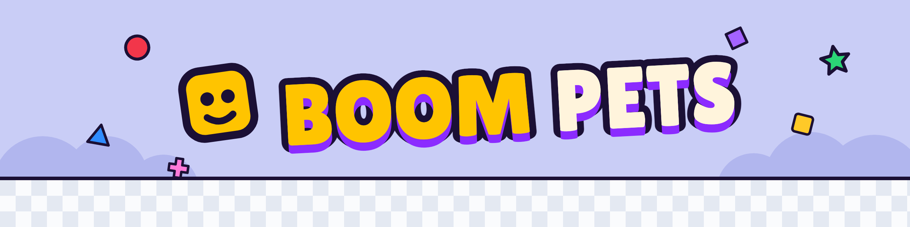
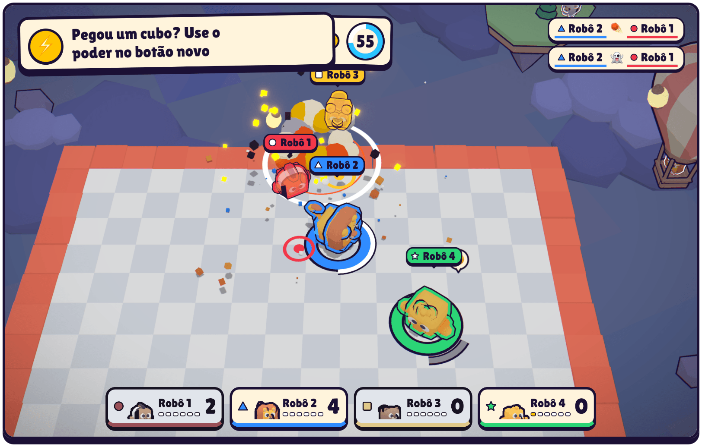
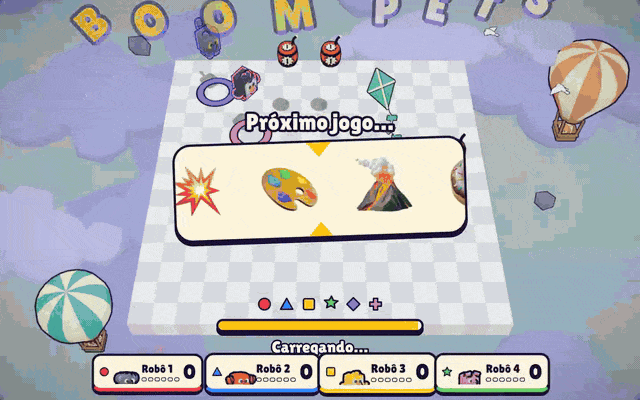
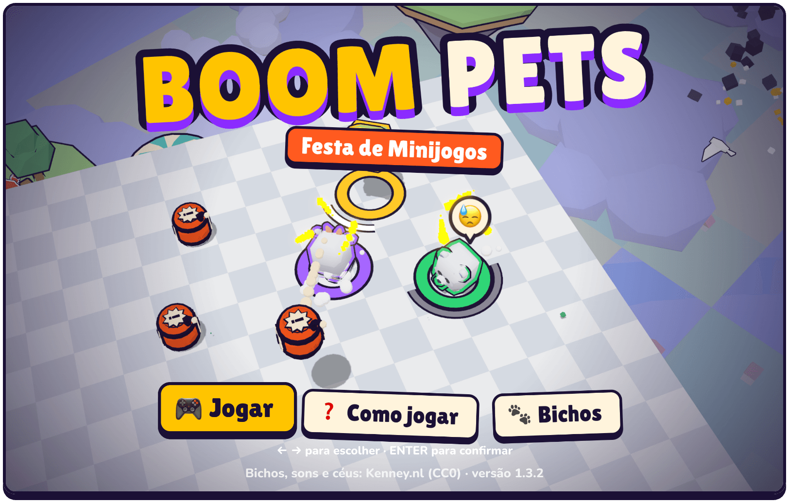
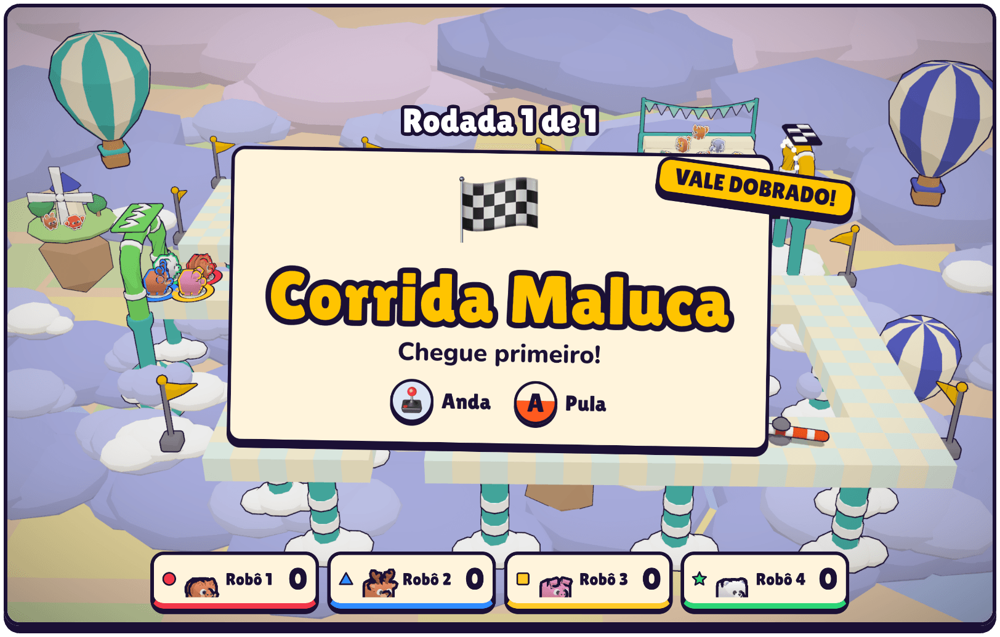
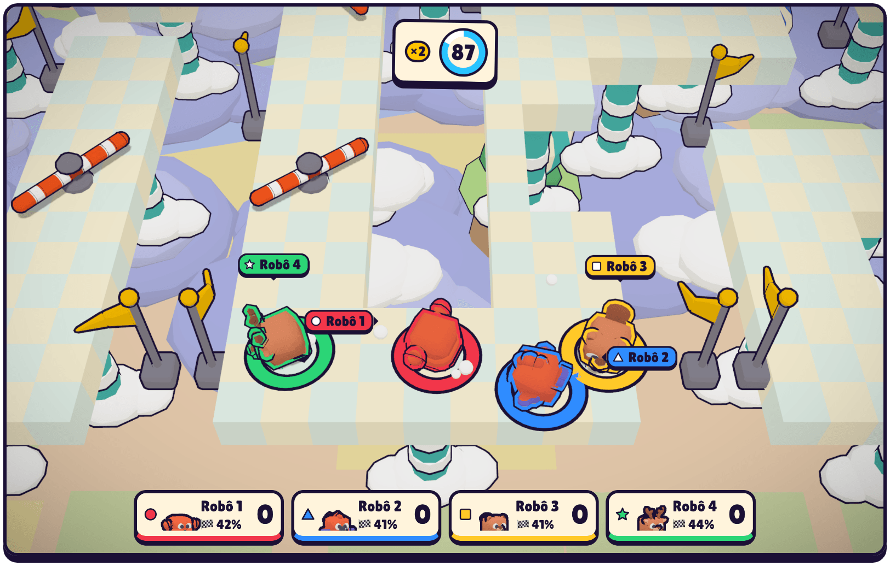
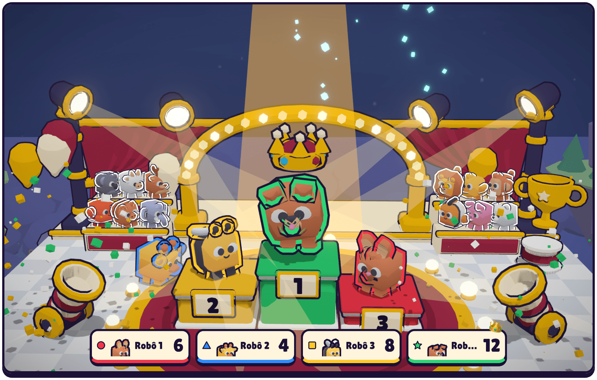
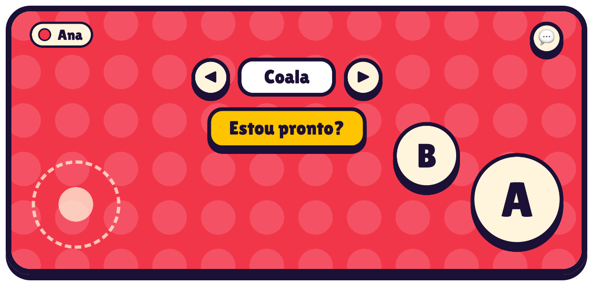
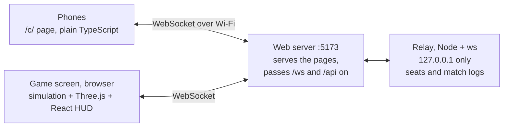

<div align="center">

<picture>
  <source media="(prefers-color-scheme: dark)" srcset="docs/assets/banner-dark.png">
  
</picture>

**[Install](#install) · [How to play](#how-to-play) · [Games](#the-games) · [Português](README.pt-BR.md)**

<a href="LICENSE"></a>


<br><br>



</div>

## Scan a code, pick a pet, and knock your friends off the table.

Boom Pets is a party game for one room. The computer plugged into the TV is the game screen, and every phone is a joystick: friends scan a QR code on the same Wi-Fi and play in the browser, with nothing to install. A match is a handful of short rounds, and a roulette draws a different game for each one. It exists for the thirty seconds after someone scans the code, when the first pet goes flying and the whole room laughs, the one who fell included.

> [!NOTE]
> Everything on screen and on the phones is in Brazilian Portuguese.

## Features

- **Eight games, one roulette.** A brawl and seven quick games, each explained by one line on its card.
- **Phones are the controllers.** Scan, type a nickname, pick a pet: no app, no account.
- **One to six players.** Bots fill the empty seats, and a phone that drops gets its pet back.
- **One button, at most.** Outside the brawl every game is a joystick and A, and the phone says what A does there.
- **A toy box in 3D.** Twenty-four pets, a map for every game modelled in Blender, an announcer, music and plenty of KABUM!
- **Every match is logged.** `pnpm report` turns the logs into a playtest report on how each game plays.

## Install

> [!NOTE]
> You need [Node.js](https://nodejs.org) (developed on 25.9) and [pnpm](https://pnpm.io) 11, a computer with a WebGL 2 browser (Chrome, Edge or Safari) to show the game, ideally on a TV, and phones on the same Wi-Fi as the computer. It is developed and tested on macOS; Linux should work, Windows is untested.

```bash
git clone https://github.com/PHMFG/boom-pets.git
cd boom-pets
pnpm install
pnpm play
```

`pnpm play` builds the game and serves it on port 5173. Open **http://localhost:5173** on the computer itself: only a page opened at `localhost` can be the game screen.

> [!TIP]
> No phones at hand? Open http://localhost:5173/?solo&autostart for a match of bots.

## How to play

A night with three friends:

1. Open http://localhost:5173 on the computer by the TV and press **Enter** on **Jogar**.
2. Each friend points the phone's camera at the QR code, types a nickname, picks a pet with the arrows and taps **Estou pronto?**. When everyone is ready, the match starts.
3. The roulette draws a game, and its card says what to do and what A does. Five rounds later (press **R** in the lobby for three) the podium crowns the winner.
4. **Enter** plays again; **Esc** goes back to the lobby.

| Key | On the computer |
| --- | --- |
| Enter | Start a match, or a rematch |
| Esc | Back to the lobby from the results |
| R · B | In the lobby: 5 or 3 rounds · bots on or off |
| M · S | Less shake and glow · sound on or off |
| 1 to 6 | Buzz that seat's phone |

In the brawl the phone has a stick, **A** (tap to shove, hold and release to dash), **B** (grab, then throw) and a power button when a Mystery Cube gives you a power. Every other game has the stick and, at most, A.

### The games

| Game | What you do |
| --- | --- |
| **Bate-Bate** | Knock everyone off a shrinking platform: dash, grab, throw, and use powers. Out? Come back as a ghost dropping meteors. |
| **Batata Quente** | Bump into someone to pass the bomb before its fuse runs out. |
| **Batatinha Frita 1, 2, 3** | Creep up while the giant cat sings. Still moving when it turns? Back to the start. |
| **Come e Cresce** | Eat everything and bite smaller pets: the biggest wins. |
| **Cor Certa** | Run to the colour that is called before the other patches drop. |
| **Corrida Maluca** | Race a track drawn afresh every round: jump the gaps, dodge the sweeping bars. |
| **O Chão é Lava** | Climb the furniture falling from the sky. The lava never stops rising. |
| **Pinta o Chão** | Paint more of the floor than anyone else. |

<details>
<summary><b>More screens</b></summary>
<br>

<p align="center">

</p>









<p align="center">

</p>

</details>

## How it works



The game screen runs the whole game: a deterministic simulation at 60 ticks a second (`packages/game`, with [Rapier](https://rapier.rs) for bodies bumping into each other) that the 3D view only reads. The relay passes each phone's stick and buttons to it, keeps the seats so a reload loses nobody, and saves a log of every match.

## Develop

```bash
pnpm dev          # serve the source; pages reload on save
pnpm test         # unit tests
pnpm typecheck
pnpm test:e2e     # real browsers: the game screen and up to six phones
pnpm fake 4       # four simulated phones that play by themselves
pnpm look race    # pictures of a round of a game, saved to test-results/look
```

[`AGENTS.md`](AGENTS.md) maps the code and its conventions. [`docs/DESIGN.md`](docs/DESIGN.md) says how the game looks, moves and sounds, [`docs/GAMEPLAY.md`](docs/GAMEPLAY.md) how it plays and why, and [`CHANGELOG.md`](CHANGELOG.md) what changed in each version.

## Roadmap

As of 1.3.2:

- [x] Bate-Bate: dash, grab and throw, barrels, Mystery Cubes with eleven powers, ghosts with meteors
- [x] Seven more games, drawn by a roulette between rounds
- [x] One to six players on phones, bots in the empty seats, seats kept through a dropped connection
- [x] A drawn race track every round, and O Chão é Lava as a climb
- [x] Announcer, music, a map for every game, a podium at the end
- [x] Match logs and a playtest report
- [ ] The game's text in English

## License and credits

The code is under the [MIT License](LICENSE). The assets below keep their own terms, and the MIT License does not cover them:

- Pet models, impact sounds and skyboxes: [Kenney](https://kenney.nl), CC0.
- Fonts: [Lilita One](https://fonts.google.com/specimen/Lilita+One) and [Nunito](https://fonts.google.com/specimen/Nunito), SIL Open Font License 1.1, through [Fontsource](https://fontsource.org).
- Music (`apps/web/public/music`): made with [Producer.ai](https://producer.ai) and used under its terms.
- Announcer (`apps/web/public/voice`): recorded with a macOS system voice and subject to Apple's terms.

Built with [Three.js](https://threejs.org) (MIT), [postprocessing](https://github.com/pmndrs/postprocessing) (Zlib), [React](https://react.dev) (MIT), [Rapier](https://rapier.rs) (Apache-2.0), [Zod](https://zod.dev) (MIT), [ws](https://github.com/websockets/ws) (MIT), [uqr](https://github.com/unjs/uqr) (MIT) and [Vite](https://vite.dev) (MIT), and tested with [Vitest](https://vitest.dev) (MIT) and [Playwright](https://playwright.dev) (Apache-2.0).
