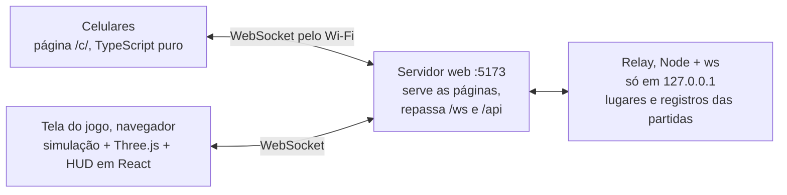

<div align="center">

<picture>
  <source media="(prefers-color-scheme: dark)" srcset="docs/assets/banner-dark.png">
  
</picture>

**[Instalação](#instalação) · [Como jogar](#como-jogar) · [Jogos](#os-jogos) · [English](README.md)**

<a href="LICENSE"></a>


<br><br>


</div>

## Leia o código, escolha um bicho e jogue seus amigos pra fora.

Boom Pets é um jogo de festa para uma sala. O computador ligado à TV é a tela do jogo, e cada celular vira um controle: os amigos leem um QR code na mesma rede Wi-Fi e jogam no navegador, sem instalar nada. Uma partida tem algumas rodadas curtas, e uma roleta sorteia um jogo diferente para cada uma. Ele existe pelos trinta segundos depois que alguém lê o código, quando o primeiro bicho sai voando e a sala inteira ri, inclusive quem caiu.

> [!NOTE]
> Todo o texto da tela e dos celulares está em português do Brasil.

## Recursos

- **Oito jogos, uma roleta.** Uma briga e sete jogos rápidos, cada um explicado em uma linha no seu card.
- **Os celulares são os controles.** Leia o código, digite um apelido, escolha um bicho: sem app e sem conta.
- **De um a seis jogadores.** Robôs ocupam os lugares vazios, e um celular que cai recupera o seu bicho.
- **No máximo um botão.** Fora da briga, todo jogo é joystick e A, e o celular diz o que o A faz ali.
- **Uma caixa de brinquedos em 3D.** Vinte e quatro bichos, um mapa para cada jogo modelado no Blender, locutor, música e muito KABUM!
- **Toda partida vira registro.** O `pnpm report` transforma os registros num relatório de como cada jogo está sendo jogado.

## Instalação

> [!NOTE]
> Você precisa do [Node.js](https://nodejs.org) (desenvolvido na 25.9) e do [pnpm](https://pnpm.io) 11, de um computador com um navegador com WebGL 2 (Chrome, Edge ou Safari) para mostrar o jogo, de preferência numa TV, e de celulares na mesma rede Wi-Fi do computador. Ele é desenvolvido e testado no macOS; no Linux deve funcionar, e no Windows não foi testado.

```bash
git clone https://github.com/PHMFG/boom-pets.git
cd boom-pets
pnpm install
pnpm play
```

O `pnpm play` gera o build do jogo e o serve na porta 5173. Abra **http://localhost:5173** no próprio computador: só uma página aberta em `localhost` pode ser a tela do jogo.

> [!TIP]
> Sem celulares por perto? Abra http://localhost:5173/?solo&autostart para ver uma partida de robôs.

## Como jogar

Uma noite com três amigos:

1. Abra http://localhost:5173 no computador ligado à TV e aperte **Enter** em **Jogar**.
2. Cada amigo aponta a câmera do celular para o QR code, digita um apelido, escolhe um bicho com as setas e toca em **Estou pronto?**. Quando todo mundo estiver pronto, a partida começa.
3. A roleta sorteia um jogo, e o card dele diz o que fazer e o que o A faz. Cinco rodadas depois (aperte **R** no lobby para três), o pódio coroa quem venceu.
4. **Enter** joga de novo; **Esc** volta ao lobby.

| Tecla | No computador |
| --- | --- |
| Enter | Começa uma partida, ou a revanche |
| Esc | Volta ao lobby a partir do resultado |
| R · B | No lobby: 5 ou 3 rodadas · robôs ligados ou não |
| M · S | Menos tremor e brilho · som ligado ou não |
| 1 a 6 | Faz o celular daquele lugar vibrar |

Na briga, o celular tem o joystick, o **A** (um toque empurra; segure e solte para dar um dash), o **B** (agarra e depois arremessa) e um botão de poder quando um Cubo Misterioso te dá um poder. Todo outro jogo tem o joystick e, no máximo, o A.

### Os jogos

| Jogo | O que fazer |
| --- | --- |
| **Bate-Bate** | Jogue todo mundo pra fora de uma plataforma que encolhe: dash, agarrão, arremesso e poderes. Caiu? Volte como fantasma jogando meteoros. |
| **Batata Quente** | Esbarre em alguém para passar a bomba antes que o pavio acabe. |
| **Batatinha Frita 1, 2, 3** | Avance enquanto o gato gigante canta. Ainda se mexendo quando ele vira? De volta ao começo. |
| **Come e Cresce** | Coma tudo e morda os bichos menores: o maior vence. |
| **Cor Certa** | Corra para a cor chamada antes que os outros pedaços do chão caiam. |
| **Corrida Maluca** | Corra numa pista desenhada de novo a cada rodada: pule os buracos e desvie das barras que giram. |
| **O Chão é Lava** | Suba nos móveis que caem do céu. A lava não para de subir. |
| **Pinta o Chão** | Pinte mais do chão do que todo mundo. |

<details>
<summary><b>Mais telas</b></summary>
<br>

<p align="center">

</p>


<p align="center">

</p>

</details>

## Como funciona



A tela do jogo roda o jogo inteiro: uma simulação determinística a 60 passos por segundo (`packages/game`, com o [Rapier](https://rapier.rs) para os bichos se esbarrarem) que a visão em 3D apenas lê. O relay entrega a ela o joystick e os botões de cada celular, guarda os lugares para que recarregar a página não tire ninguém do jogo e salva um registro de cada partida.

## Desenvolvimento

```bash
pnpm dev          # serve o código-fonte; as páginas recarregam ao salvar
pnpm test         # testes de unidade
pnpm typecheck
pnpm test:e2e     # navegadores de verdade: a tela do jogo e até seis celulares
pnpm fake 4       # quatro celulares simulados que jogam sozinhos
pnpm look race    # fotos de uma rodada de um jogo, salvas em test-results/look
```

O [`AGENTS.md`](AGENTS.md) mapeia o código e as convenções. O [`docs/DESIGN.md`](docs/DESIGN.md) diz como o jogo se parece, se move e soa, o [`docs/GAMEPLAY.md`](docs/GAMEPLAY.md) como ele se joga e por quê, e o [`CHANGELOG.md`](CHANGELOG.md) o que mudou em cada versão. Esses documentos estão em inglês.

## Roadmap

Na versão 1.3.2:

- [x] Bate-Bate: dash, agarrão e arremesso, barris, Cubos Misteriosos com onze poderes, fantasmas com meteoros
- [x] Mais sete jogos, sorteados por uma roleta entre as rodadas
- [x] De um a seis jogadores nos celulares, robôs nos lugares vazios, lugares guardados quando a conexão cai
- [x] Uma pista de corrida desenhada a cada rodada, e O Chão é Lava como escalada
- [x] Locutor, música, um mapa para cada jogo e um pódio no fim
- [x] Registros das partidas e um relatório de playtest
- [ ] O texto do jogo em inglês

## Licença e créditos

O código está sob a [Licença MIT](LICENSE). Os assets abaixo seguem os próprios termos, e a Licença MIT não os cobre:

- Modelos dos bichos, sons de impacto e céus: [Kenney](https://kenney.nl), CC0.
- Fontes: [Lilita One](https://fonts.google.com/specimen/Lilita+One) e [Nunito](https://fonts.google.com/specimen/Nunito), SIL Open Font License 1.1, pelo [Fontsource](https://fontsource.org).
- Músicas (`apps/web/public/music`): feitas com o [Producer.ai](https://producer.ai) e usadas sob os termos dele.
- Locutor (`apps/web/public/voice`): gravado com uma voz do sistema do macOS e sujeito aos termos da Apple.

Feito com [Three.js](https://threejs.org) (MIT), [postprocessing](https://github.com/pmndrs/postprocessing) (Zlib), [React](https://react.dev) (MIT), [Rapier](https://rapier.rs) (Apache-2.0), [Zod](https://zod.dev) (MIT), [ws](https://github.com/websockets/ws) (MIT), [uqr](https://github.com/unjs/uqr) (MIT) e [Vite](https://vite.dev) (MIT), e testado com [Vitest](https://vitest.dev) (MIT) e [Playwright](https://playwright.dev) (Apache-2.0).
